  

  
  
  
  

  

### Hello, I'm Jesús 👋

Building for the web since 2003. I work on **web accessibility, front-end and technical SEO/GEO**, and I build open-source tools that bring accessibility into modern development workflows — with evidence for human review, not just automated verdicts.

- **I build:** accessibility tooling, front-end utilities and technical SEO/GEO work.
- **I focus on:** WCAG 2.2, AI-agent workflows, honest evidence over automated checkmarks.
- **I explore:** agent skills and drift, AI crawler traffic, formats for the web.

### Languages & tools

  

### Featured work

| Project | What it does | Explore |
| --- | --- | --- |
| **a11y-toolkit** | The accessibility layer for AI coding agents: WCAG 2.2 static and rendered audits, remediation and evidence for human review. Powers [a11y.es](https://a11y.es). | [Source](https://github.com/kinti/a11y-toolkit) · [Action](https://github.com/kinti/a11y-toolkit-action) |
| **wcag22-gl** | Unofficial translation of WCAG 2.2 into Galician — the first WCAG version in that language. | [Source](https://github.com/kinti/wcag22-gl) |
| **crawlward** | Watchdog for AI crawlers at your own origin — access-log analyzer for Caddy/nginx. | [Source](https://github.com/kinti/crawlward) |
| **driftcheck** | Cross-layer updater for agent skills, MCP servers and plugins — one drift pass, with snapshots and rollback. | [Source](https://github.com/kinti/driftcheck) |
| **svb** | Scalable Vector Binary: a binary vector-image format for the web, with spec, reference implementation and benchmarks. | [Source](https://github.com/kinti/svb) |

### GitHub in motion 🐍

  <picture>
    <source media="(prefers-color-scheme: dark)" srcset="https://raw.githubusercontent.com/kinti/kinti/output/github-contribution-grid-snake-dark.svg" />
    <source media="(prefers-color-scheme: light)" srcset="https://raw.githubusercontent.com/kinti/kinti/output/github-contribution-grid-snake.svg" />
    
  </picture>

The contribution animation refreshes automatically via GitHub Actions.

### GitHub insights

<picture>
  <source media="(prefers-color-scheme: dark)" srcset="./assets/insights/overview.dark.svg" />
  
</picture>
<picture>
  <source media="(prefers-color-scheme: dark)" srcset="./assets/insights/contributions.dark.svg" />
  
</picture>
<picture>
  <source media="(prefers-color-scheme: dark)" srcset="./assets/insights/languages.dark.svg" />
  
</picture>

### More things I've built

- **[a11y-toolkit-action](https://github.com/kinti/a11y-toolkit-action)** — audit URLs with the a11y-toolkit engine from GitHub Actions.
- **[a11y-watch](https://github.com/kinti/a11y-watch)** — weekly WCAG 2.2 accessibility watchdog: audit + SARIF in GitHub Actions.
- **[spamcha](https://github.com/kinti/spamcha)** — invisible antispam for web forms: no captcha, no cloud.
- **[neon-void](https://github.com/kinti/neon-void)** — 3D neon-style arcade game with Babylon.js and TypeScript.
- **[casita-viva](https://github.com/kinti/casita-viva)** — a toy house that lives: care, cook, decorate. One single file.

> Automated checks help find barriers. Understanding their impact still requires human review.

### En español

Trabajo en accesibilidad web, desarrollo front-end y SEO técnico. Desarrollo [a11y-toolkit](https://github.com/kinti/a11y-toolkit) y [a11y.es](https://a11y.es), y comparto herramientas de código abierto desde Galicia.

Me interesa hacer más fácil la detección de barreras y la documentación de los resultados, con una revisión humana que tenga en cuenta la experiencia de uso. Para colaboración profesional, [escríbeme](https://jquin.net/contacto/).

---

  Built with care from Galicia · Keep the web accessible.

