# Jesús Quintana

**Web accessibility · Front-end · Technical SEO -> GEO**

I work on web accessibility, front-end development and technical GEO. Building for the web since 2003, from Galicia, Spain.

[Website & writing](https://jquin.net/) · [a11y.es](https://a11y.es/) · [Contact](https://jquin.net/contacto/) · [Work](https://maismedia.com)

## What I'm building

**[a11y-toolkit](https://github.com/kinti/a11y-toolkit)** brings accessibility checks into AI coding workflows, with tools for remediation and evidence for human review. It is used in [a11y.es](https://a11y.es/).

Automated checks help find barriers. Understanding their impact and assessing the user experience still requires human review.

## More open source

| Project | What it does |
| --- | --- |
| [crawlward](https://github.com/kinti/crawlward) | Analyze AI crawler traffic from server access logs, with optional IP verification. |
| [driftcheck](https://github.com/kinti/driftcheck) | Check and update agent skills, MCP servers and plugins, with snapshots and rollback. |
| [svb](https://github.com/kinti/svb) | A binary vector image format with a specification, reference implementation and benchmarks. |

## Get involved

Bug reports, reproducible examples and documentation improvements are welcome. For technical feedback, open an issue in the relevant repository.

For professional collaboration, [get in touch](https://jquin.net/contacto/).

## En español

Trabajo en accesibilidad web, desarrollo front-end y SEO técnico. Desarrollo a11y-toolkit y a11y.es, y comparto herramientas de código abierto desde Galicia.

Me interesa hacer más fácil la detección de barreras y la documentación de los resultados, con una revisión humana que tenga en cuenta la experiencia de uso.

## GitHub in motion 🐍

  <picture>
    <source media="(prefers-color-scheme: dark)" srcset="https://raw.githubusercontent.com/kinti/kinti/output/github-contribution-grid-snake-dark.svg" />
    <source media="(prefers-color-scheme: light)" srcset="https://raw.githubusercontent.com/kinti/kinti/output/github-contribution-grid-snake.svg" />
    
  </picture>

The contribution animation refreshes automatically via GitHub Actions.

## GitHub insights

<picture>
  <source media="(prefers-color-scheme: dark)" srcset="./assets/insights/overview.dark.svg" />
  
</picture>
<picture>
  <source media="(prefers-color-scheme: dark)" srcset="./assets/insights/contributions.dark.svg" />
  
</picture>
<picture>
  <source media="(prefers-color-scheme: dark)" srcset="./assets/insights/languages.dark.svg" />
  
</picture>
